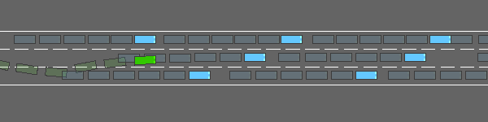

# A Comprehensive Study of Bugs in Multi-modal Agents

## About
This repository contains the data, code and results for the paper "A Comprehensive Study of Bugs in Multi-modal Agents".
The following information is included:

1. We provide the source agents, related issues / pull requests and our step-by-step annotation results. (see [Data.md](./data/Data.md) directory).

2. In RQ1 and RQ2, we analyze the distribution and relationships of symptoms and root causes. Their source data and our statistical results also shown [here](./experiment/).

3. In RQ3, we implementated MATester to prove the applicability of our taxonomy. The source code of MATester, used test cases, tested agents and tested results are available. Please refer to [MATester.md](./MATester/MATester.md) for more information.

## Case studies
 
We offer two typical cases exhibiting issues summarized in our study. One case illustrates CR aroused by the united issues of the Peceptor and the Executor. And the other displays a severe traffic accident directly caused by the Planner and also revealing Perceptor issues.

### A GUI automated M-agent that crashes because of issues in the Perceptor and the Executor

AI-browser is a M-agent that conducts a user-specified task on the PC browser. It is detected with CR when executing the `find a random music` task. Delving down to the functionality components, we found issues related to both the Perceptor and the Executor. 

The $snapshot_1$ is not similar to the $environment_1$ and the labels are missing, exhibiting the W-S and WL-S symptoms. Both of them are caused by CC. The $snapshot_1$ is generated before the environment completes rendering, so it is different from $environment_1$. Additionally, there is no happen-before relationship between labeling and screen recording, causing WL-S. Taking the wrong snapshot, the Planner generates a plan accesses an unavailable element. The Executor executes the plan and the M-agent crashes with ``TypeError``: "Cannot destructure property 'x' of 'label' as it is undefined.". 


These perception issues further affect the Planner, disabling it to locate interactive elements in the $snapshot_1$ through labels. Instead, the Planner generates a plan accessing an unavailable element: `{"action": "type", "element": 11, "text": "random music"}`. However, when the Executor takes over control, the ``TypeError`` is reported with the information "Cannot destructure property 'x' of 'label' as it is undefined.". The phenomenon displays the IA-A symptom caused by IEH, as the availability of the accessed element is not checked.

To sum up, this case shows CR caused by the problem of both the Perceptor and the Executor. Due to CC, the Perceptor generates an environment-irrelevant snapshot with no labels. The Executor takes the plan with an incorrect label and conducts the action on an unavailable interactive element without checking the existence of the element in advance.


### An automated driving M-agent that crashes into another car because of the Perceptor and the Planner

DriveLikeAHuman is a M-agent that conducts automatic driving on a highway with heavy traffics. In a randomly initialized environment with 3 lanes and 7 cars, we observe a crash accident. 

First of all, we notice that the Perceptor manifests the W-S issue in the 4-th interaction round. The $environment_4$ and $snapshot_4$ are shown below. The $snapshot_4$ is different from $environment_4$ from two aspects: 1). The lane_3 does not exist in the environment. 2). Two cars are missing in the snapshot. By randomly setting the initial environmnet, we reveal weaknesses in its Perceptor.


<center>environment_4</center>

```text
{
	"lanes": [..., 
		{"id": "lane_3", "lane index": 3, "left_lanes": ["lane_0", "lane_1", "lane_2"], "right_lanes": []}
	], 
	"vehicles": [
		{"id": "ego", "current lane": "lane_1", "lane position": 289.19, "speed": 20.02}, 
		{"id": "veh1", "current lane": "lane_0", "lane position": 289.1, "speed": 15.42}, 
		{"id": "veh2", "current lane": "lane_2", "lane position": 301.23, "speed": 16.59}, 
		{"id": "veh3", "current lane": "lane_1", "lane position": 313.68, "speed": 16.34}, 
		{"id": "veh4", "current lane": "lane_0", "lane position": 321.8, "speed": 15.24}
	],
	...
}
```
<center>snapshot_4</center>

Although the snapshot is incomplete, it contains the correct information of the crashed cars. However, the Planner makes a wrong decision (US-P) that directly causes the accident. Given the information that there is a car in the left lane, the Planner still considers it safe for the ego (green car) to turn left, causing the ego to crash into the car in the left lane. Such an US-P issue is caused by LL, as the LLM has difficulty extracting constraints embeded in the snapshot.

In summary, this traffic accident is directly caused by the Planner. By analyzing the inter-component outputs, we also observe the potential weaknesses in the Perceptor. This case demonstrates that the LLM is unreliable, urging the developers to double-check its output when applying it to safety-critical scenarios.


## Note

- We thank a lot for the wonderful open source agents used in this repositories.
